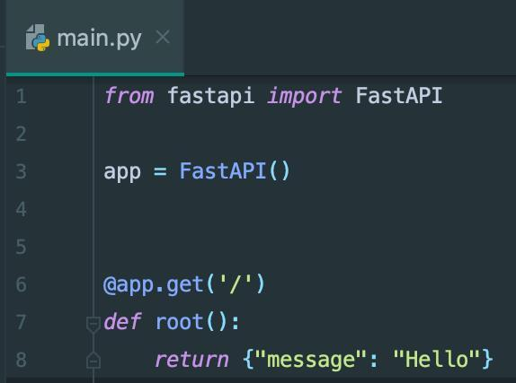
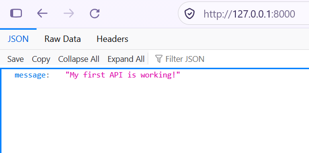
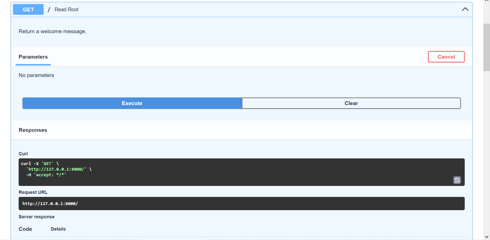
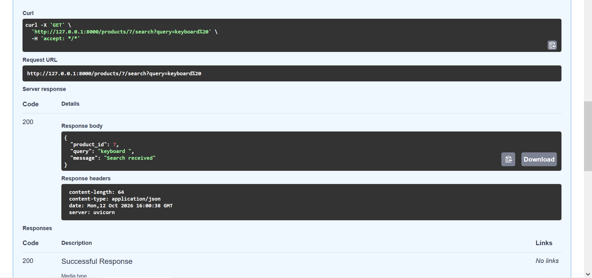
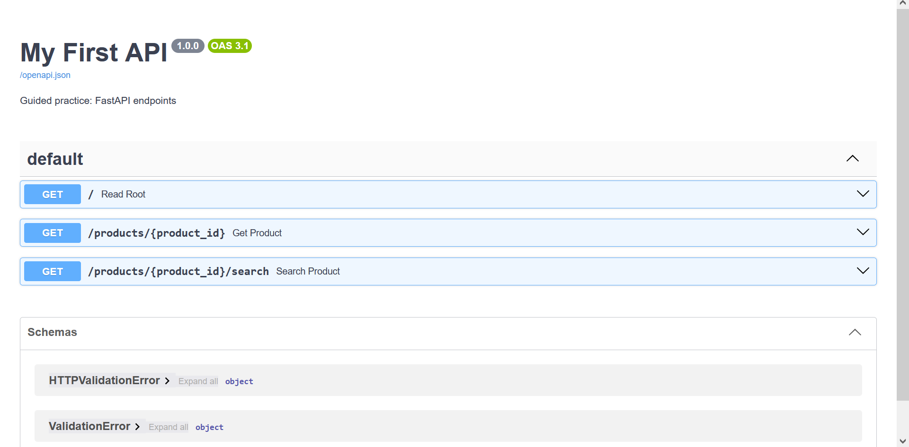

# Práctica guiada: primera API con FastAPI

## Objetivos

Al finalizar la práctica podrás:

* Crear una aplicación básica con FastAPI.
* Definir endpoints GET.
* Utilizar parámetros de ruta y de consulta.
* Ejecutar una API con Uvicorn.
* Probar endpoints mediante Swagger UI.

## Requisitos

* Python 3.10 o superior.
* Git.
* Un editor de código, como VS Code.

## 1. Clonar el repositorio

Copia la URL del repositorio de GitHub y ejecuta:

```bash
git clone https://github.com/Isbelita-dot/fastapi-practica-guiada-es.git
cd fastapi-practica-guiada-es
```

## 2. Crear un entorno virtual

En Windows PowerShell:

```powershell
python -m venv .venv
.\.venv\Scripts\Activate.ps1
```

En macOS o Linux:

```bash
python3 -m venv .venv
source .venv/bin/activate
```

## 3. Instalar las dependencias

```bash
python -m pip install -r requirements.txt
```

## 4. Ejecutar la aplicación

Ejecuta:

```bash
uvicorn main:app --reload
```

Abre en el navegador:

* http://127.0.0.1:8000/
* http://127.0.0.1:8000/docs

Mantén la terminal abierta mientras realizas la práctica.

## 5. Seguir los pasos de la práctica

Abre `main.py` en el editor de código. Sigue los pasos en orden y guarda los cambios cada vez que descomentes un bloque.

### Paso 1. Comprobar el endpoint inicial

1. Revisa el código del endpoint inicial en `main.py`.
2. Comprueba que la aplicación está ejecutándose.
3. Abre http://127.0.0.1:8000/ en el navegador.

**Captura 1. Definición del endpoint inicial**



### Paso 2. Consultar la respuesta JSON

1. Visita http://127.0.0.1:8000/.
2. Observa la respuesta que devuelve la API en formato JSON.
3. Identifica los datos que aparecen en la respuesta.

**Captura 2. Respuesta JSON del endpoint inicial**



### Paso 3. Utilizar un parámetro de ruta (*path parameter*)

1. Vuelve a `main.py`.
2. Descomenta el bloque correspondiente al paso 2.
3. Guarda el archivo.
4. Abre http://127.0.0.1:8000/docs.
5. Busca el endpoint `GET /productos/{producto_id}`.
6. Pulsa **Try it out**, introduce `7` y pulsa **Execute**.

**Captura 3. Prueba del parámetro de ruta**



### Paso 4. Utilizar un parámetro de consulta (*query parameter*)

1. Descomenta el bloque correspondiente al paso 3 en `main.py`.
2. Guarda el archivo.
3. En `/docs`, busca el endpoint `GET /productos/{producto_id}/buscar`.
4. Pulsa **Try it out**, introduce `7` como identificador y `teclado` como parámetro de búsqueda.
5. Pulsa **Execute** y observa la respuesta.

También puedes probar la petición directamente:

`GET /productos/7/buscar?buscar=teclado`

**Captura 4. Prueba del parámetro de consulta**



### Paso 5. Revisar la documentación final

1. Abre http://127.0.0.1:8000/docs.
2. Comprueba que aparecen los endpoints disponibles.
3. Expande los endpoints y revisa sus parámetros y respuestas.
4. Prueba la búsqueda sin proporcionar el parámetro de consulta, si el código permite omitirlo.

Ejemplo de petición sin parámetro de consulta:

`GET /productos/7/buscar`

**Captura 5. Documentación final de FastAPI**



## Conceptos clave

* **Endpoint:** combinación de una ruta y un método HTTP que permite acceder a una operación.
* **GET:** método utilizado habitualmente para consultar información.
* **Path parameter:** valor incluido en la ruta, como el identificador de un producto.
* **Query parameter:** valor enviado después del símbolo `?` en la URL.
* **Swagger UI:** interfaz interactiva disponible en `/docs` para explorar y probar la API.

## Referencias

* https://fastapi.tiangolo.com/
* https://github.com/fastapi/fastapi
